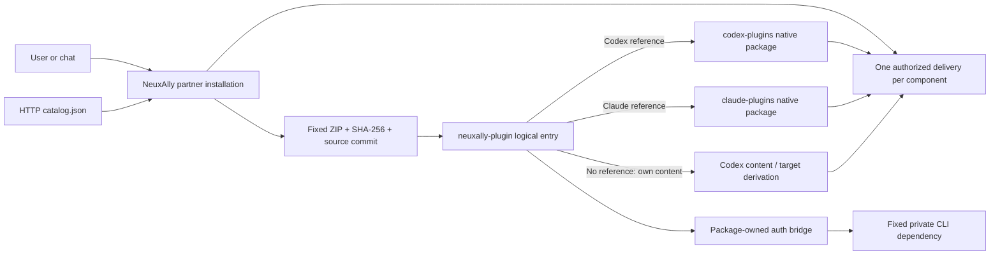

# NeuxAlly Plugins

[English](README.md) | [简体中文](README.zh-CN.md)

Public, independently maintained plugin sources for [NeuxAlly](https://github.com/JieWaZi/NeuxAlly). The application discovers catalog metadata over HTTP and downloads a fixed, verified snapshot when a user installs a plugin for a partner.

| System plugin | Content and origin | Target selection |
| --- | --- | --- |
| [GitHub](neuxally-plugin/github/README.md) | Complete native packages from OpenAI and the official Claude marketplace | Codex → OpenAI GitHub; Claude Code → Claude GitHub |
| [Feishu Office](neuxally-plugin/feishu-office/README.md) | NeuxAlly Codex package with complete upstream Lark skills and a package-owned authorization bridge | Own Codex content; other targets may derive compatible content |

Catalog presence, archive availability, CLI loading, and live account verification are separate facts. Tests here cover packaging and authorization protocol behavior; they do not establish live account or every target CLI compatibility.

## Install and use

In a NeuxAlly host supporting catalog v2, open the plugin library, select a system plugin and install it for a partner, then complete the declared authorization when required. Chat installation must use the host's discovered `allycli` plugin installation capability, which invokes the same use case. It must not edit the user's global Codex or Claude plugin registry.

A **system plugin** is the logical entry installed once for a partner. Its version, account and relationship remain stable while the host chooses an implementation for the current CLI. `neuxally-plugin/github` only references real native packages; it does not repackage their MCP definitions. An explicit native reference wins; only a target without a reference may use existing own content. A pure reference entry without a target implementation fails explicitly.

For direct native use, [.agents/plugins/marketplace.json](.agents/plugins/marketplace.json) indexes Codex content and [.claude-plugin/marketplace.json](.claude-plugin/marketplace.json) indexes the actual Claude package. Consult `codex plugin --help` or `claude plugin --help` for your installed CLI's supported commands and scopes. Native use does not automatically provide NeuxAlly accounts, authorization UI, or private dependency environments. Pin a reviewed commit/local snapshot when the CLI cannot freeze a marketplace version.



## Repository layout

- `codex-plugins/`: complete, unmodified upstream Codex packages, including apps, MCP declarations and assets, plus clearly identified provenance additions.
- `claude-plugins/`: real upstream Claude packages, including all native components and available licenses.
- `neuxally-plugin/`: system logical entries and own standard Codex content. Identity is in `.codex-plugin/plugin.json`; optional `.neuxally/integration.json` only adds native references and authorization, never a second component inventory.
- `patches/`: publicly reviewable CLI isolation patches, regression sources and historical third-party notices.
- `scripts/`: deterministic catalog/ZIP and fixed dependency builds. Generated `dist/` is ignored.

The GitHub native implementations intentionally differ. OpenAI's package retains its managed `.app.json` and public OAuth client declaration; these do not guarantee a host can supply that managed connection. Claude's package requires `GITHUB_PERSONAL_ACCESS_TOKEN` through protected configuration. Tokens must stay private; a distributed public OAuth client secret is not a user credential. See each package's original files and [provenance](THIRD_PARTY_NOTICES.md).

## Author an own Codex plugin

Create `neuxally-plugin/<key>/.codex-plugin/plugin.json` with standard `name`, `version`, `description` and truthful authorship/license fields. Add complete `skills/`, `.mcp.json` and other supported native components using the official [Codex packaging documentation](https://developers.openai.com/plugins/build/plugins). Keep scripts, references, assets and executable modes; do not hand-write another manifest format. A package without `.neuxally/` remains a standard package.

When collecting upstream content, inspect the actual repository and marketplace, choose a full commit, copy the entire package tree without rewriting its native declarations, and retain its author, copyright, available license, source path and per-file digest in `provenance.json`. Review native dependencies and host limits. A directory name or similar product name is not proof of an equivalent implementation; do not invent a missing native package. A license declared in a manifest is recorded as that evidence, not replaced by an invented copyright notice.

To connect verified native sources, add this optional package-local extension:

```json
{
  "nativePlugins": {
    "codex": { "path": "codex-plugins/github" },
    "claude": { "path": "claude-plugins/github" }
  }
}
```

Paths resolve from the verified source root, not from the logical package directory. Release ZIPs contain the logical entry plus its referenced native trees. Absolute paths, traversal, missing native manifests and symbolic links are rejected. A standalone imported package cannot reach outside its snapshot. Logical and native versions remain separate; an upstream package without a version is not assigned a fabricated one.

## HTTP discovery and downloads

Default metadata endpoint: [latest catalog](https://github.com/JieWaZi/NeuAally-Plugins/releases/latest/download/catalog.json). For reproducible automation, use the [fixed v2.0.0 catalog](https://github.com/JieWaZi/NeuAally-Plugins/releases/download/v2.0.0/catalog.json). These URLs become available after the maintainer publishes the release; committing source alone does not publish them.

```sh
curl --fail --location https://github.com/JieWaZi/NeuAally-Plugins/releases/download/v2.0.0/catalog.json --output catalog.json
curl --fail --location https://github.com/JieWaZi/NeuAally-Plugins/releases/download/v2.0.0/github.zip --output github.zip
shasum -a 256 github.zip
```

The generated transfer index is `{schemaVersion:2,entries:[...]}`. Each entry contains `key`, a full `sourceCommit`, immutable `archiveURL`, `archiveSHA256`, `packagePath`, `name`, logical `version`, `description` and `format: codex`. It is directory metadata, not another runtime plugin manifest. Search needs only the catalog; download the selected ZIP, verify SHA-256 before extraction, and retain the fixed source identity. A local catalog or HTTP mirror can serve the same contract. Installed snapshots must not change when `latest` advances. Never replace existing release assets in place; publish a new version.

## Authorization without provider branches

Standard MCP authentication should follow its supported declarations and discovery. For a nonstandard CLI, declare `authentication` in `.neuxally/integration.json`, choose `strategy: plugin-command`, `protocol: neuxally-auth/1`, a trusted executable and package-local arguments, then implement start/status/cancel/resolve/logout. The host owns generic sessions and action UI; the plugin interprets the provider's protocol. See the [implemented bridge contract and private resolve example](neuxally-plugin/feishu-office/.neuxally/auth/README.md).

Feishu's bridge downloads its own fixed, digest-verified isolated CLI into private data on first use, emits real successive challenges, and verifies granted identity and scopes through the official CLI. It clears inherited CLI credential overrides. The host receives safe account summaries and only passes approved component bindings through its private execution channel. A trusted host may supply the same fixed dependency through `NEUXALLY_LARK_CLI`; a new provider does not require new host download code or UI branches.

```mermaid
sequenceDiagram
  participant Host as Generic host session
  participant Bridge as Package bridge
  participant Provider as Official CLI / provider
  participant User
  Host->>Bridge: auth/start (session, private directory, scopes)
  Bridge-->>Host: pending
  Bridge->>Provider: Start actual authorization
  Provider-->>Bridge: Dynamic challenge
  Bridge-->>Host: auth/challenge (new ID, actions, available expiry)
  Host-->>User: URL / QR / code actions actually supplied
  User->>Provider: Complete authorization
  Bridge->>Provider: Verify account and scopes
  Bridge-->>Host: auth/state authorized + safe summary
  Host->>Bridge: auth/resolve (approved components)
  Bridge-->>Host: Private component bindings
  Note over Host,Bridge: Cancel waits for upstream work to stop; secrets never enter chat
```

## Build and release

Use Node 22+, Git and the pinned Go toolchain `go1.25.8` for the optional CLI dependency build. Build all six CLI targets before committing the generated asset lock, then build the catalog from that committed source. The dependency build applies the public patch and runs its targeted keychain regression; `CGO_ENABLED=0` cross-compiles fixed binaries.

```sh
npm test
node scripts/build-lark-provider.mjs
# Review and commit source plus the generated assets.lock.json first.
node scripts/build-catalog.mjs HEAD v2.0.0
```

The catalog builder takes a full commit SHA (or `HEAD`, resolved by Git) and reads Git objects only, preserving exact content and execution modes. Identical committed inputs produce identical ZIPs despite dirty working files or timestamps. It validates every reference and completes all artifacts before replacing the catalog output. Keep dependency output under `dist/providers/` when building release ZIPs; the build command preserves that directory.

After review, a maintainer can create an immutable release with `gh release create v2.0.0 --repo JieWaZi/NeuAally-Plugins --target <full-source-commit> --title 'Plugins v2.0.0' --notes-file <reviewed-release-notes> dist/catalog.json dist/*.zip dist/providers/*`. Push the exact source commit/tag only when authorized. Rebuild, license review and account/platform acceptance remain distinct responsibilities.

The root [MIT license](LICENSE) covers NeuxAlly-authored material. Third-party content retains its own terms; see [THIRD_PARTY_NOTICES.md](THIRD_PARTY_NOTICES.md).
