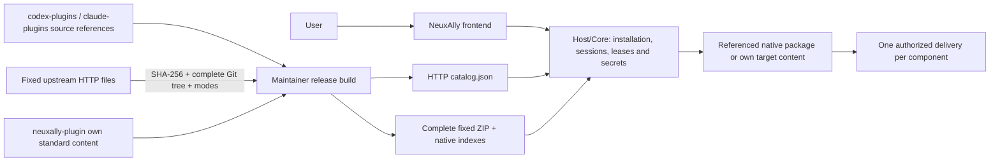
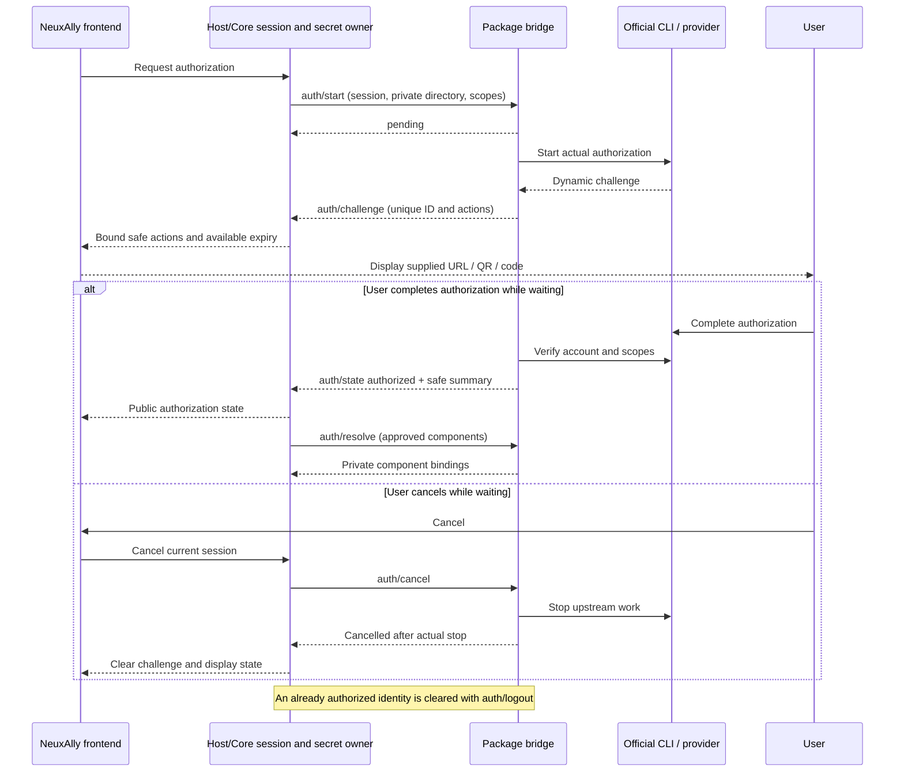

# NeuxAlly Plugins

[English](README.md) | [简体中文](README.zh-CN.md)

A plugin library and marketplace for GitHub code review/collaboration and Feishu documents, tables, calendars and tasks. [NeuxAlly](https://github.com/JieWaZi/NeuxAlly) discovers this catalog over HTTP and installs fixed, verified content for a partner.

The repository root contains a marketplace of multiple plugins, not one plugin. It therefore has no root single-plugin `plugin.json`. Standard manifests belong to each own package or to the complete native package materialized during release builds.

| Plugin | Business capabilities | Maintained content |
| --- | --- | --- |
| [GitHub](neuxally-plugin/github/README.md) | Find repository code, track issues and pull requests, review changes and collaborate | Own logical entry with fixed OpenAI and Claude native source references |
| [Feishu Office](neuxally-plugin/feishu-office/README.md) | Write documents, manage tables, arrange calendars and follow up tasks | Own standard Codex package, complete Lark skills and package-owned authorization bridge |

Catalog presence, download availability, target CLI loading and live account verification are separate facts. Publishing an archive does not prove account or platform acceptance.

## Install and use

In a NeuxAlly host supporting plugin catalogs, open the plugin library, install a plugin for a partner, and complete the declared authorization if required. Chat installation uses the host-discovered `allycli` installation capability and the same use case; it does not edit the user's global Codex or Claude registry.

A system logical plugin is installed once for a partner. It keeps one relationship and logical version while the host selects a fixed implementation for the current CLI. An explicit native reference wins; only a target without a reference may use existing own content. A pure reference entry without an applicable implementation fails explicitly.

For direct native use:

- The source [.agents/plugins/marketplace.json](.agents/plugins/marketplace.json) lists the own Feishu package that actually exists in this checkout. It does not point at a GitHub directory containing only `source.json`.
- The source [.claude-plugin/marketplace.json](.claude-plugin/marketplace.json) uses Claude's documented [`git-subdir` source](https://code.claude.com/docs/en/plugins/marketplace-reference#git-subdir-plugin-source) with a fixed commit and package path. Direct native Claude installation may use Git; the NeuxAlly HTTP installation path does not.
- Each release installation ZIP contains complete implementation files and generated local native indexes at its root. Extract `github.zip` to use its complete Codex/Claude marketplace snapshot, or `feishu-office.zip` for its own Codex snapshot. Codex GitHub's native local index is supplied in the complete release snapshot.

Consult the installed CLI's plugin help for supported commands and scopes. Native loading alone does not supply NeuxAlly accounts, private execution environments or an authorization UI. Source-only native reference directories cannot be loaded as native plugins.



## Repository layout and source registration

- `codex-plugins/`: native source addresses, full commits, upstream package paths, complete tree/file integrity locks, and necessary license evidence. Upstream source/assets are downloaded at build time.
- `claude-plugins/`: the same responsibility for actual Claude native packages; source metadata is not a loadable native package.
- `neuxally-plugin/`: own logical entries and own standard Codex content. `.codex-plugin/plugin.json` owns identity and standard components; optional `.neuxally/integration.json` only adds references and authorization.
- `patches/`: public CLI isolation patches, regression sources and truthful historical notices.
- `scripts/`: source registration, HTTP materialization, deterministic ZIP/catalog and optional dependency builds. `.cache/` and `dist/` are ignored.

To collect an upstream package, inspect the actual official repository, marketplace, authorship and license. Choose a complete commit and the real package subdirectory. Register its source and integrity lock rather than maintaining a long-lived copied source tree:

```sh
node scripts/lock-native-source.mjs codex-plugins/example https://github.com/example/plugins <full-40-character-commit> plugins/example
```

The registration command fetches the complete upstream tree metadata and files by HTTP. It records `source.json` with `repository`, `commit`, `path`, `treeSHA`, and every file's SHA-256 and Unix mode, verifies the complete Git tree, and preserves reviewed author/license metadata. Review that metadata and retain any required license evidence before committing. Symlinks, submodules, unsafe paths, duplicate files, wrong modes and incomplete trees are rejected. Current source transport supports GitHub HTTPS repositories.

The release builder fetches only these fixed files through HTTP. Each file is verified before caching; the complete package tree is verified before it can enter a ZIP. Corrupt caches are refetched and verified caches support offline rebuilds. HTTP failures cannot replace existing release output. This keeps upstream provenance explicit without committing ongoing upstream source copies.

## Own packages and native routing

Keep each plugin's English and Chinese README focused on its native capabilities, access requirements and practical uses; omit host roles, product installation flows and chat prompts. Maintain standard English interface metadata, localized display text and package-owned brand assets according to the [presentation maintenance guide](docs/MAINTAINING.md); source and implementation details belong in development documents and notices.

Create an own package at `neuxally-plugin/<key>/.codex-plugin/plugin.json` using standard identity, version, description, truthful author and license fields. Follow the official [Codex packaging documentation](https://developers.openai.com/plugins/build/plugins) for complete skills, MCP and other native components. Preserve scripts, relative references, assets and execution modes. A package without `.neuxally/` remains standard.

A logical entry can refer to reviewed native sources without duplicating their components:

```json
{
  "nativePlugins": {
    "codex": { "path": "codex-plugins/github" },
    "claude": { "path": "claude-plugins/github" }
  }
}
```

These paths resolve from the verified release source root. The source checkout contains references at those paths; the installation ZIP materializes complete native implementations at the same paths. The application consumes the same archive contract and needs no Git executable. Logical and native versions stay separate; absent upstream versions are not invented.

OpenAI GitHub retains its managed app declaration and public OAuth client configuration. Claude GitHub requires `GITHUB_PERSONAL_ACCESS_TOKEN` through protected configuration. Neither model proves the other is available in a host; user tokens must remain private. See [source and license evidence](THIRD_PARTY_NOTICES.md).

## HTTP discovery, fixed versions and offline snapshots

Use the [latest catalog](https://github.com/JieWaZi/NeuAally-Plugins/releases/latest/download/catalog.json) for discovery or the [fixed v0.1.1 catalog](https://github.com/JieWaZi/NeuAally-Plugins/releases/download/v0.1.1/catalog.json) for reproducibility. A new release is available only after its maintainer publishes it.

```sh
curl --fail --location https://github.com/JieWaZi/NeuAally-Plugins/releases/download/v0.1.1/catalog.json --output catalog.json
curl --fail --location https://github.com/JieWaZi/NeuAally-Plugins/releases/download/v0.1.1/github.zip --output github.zip
shasum -a 256 github.zip
```

Compare the downloaded digest with the selected catalog entry before extraction. The transfer index remains `{schemaVersion:2,entries:[...]}` with `key`, full `sourceCommit`, immutable `archiveURL`, `archiveSHA256`, `packagePath`, `name`, logical `version`, `description` and `format: codex`. Optional `displayNames`, `localizedDescriptions` and validated embedded `icon` provide localized presentation before downloading a package. It is directory metadata, not another plugin manifest.

Search reads only catalog metadata; installation downloads the chosen complete ZIP. An offline installation snapshot contains the logical entry, all referenced native files, integrity/license evidence and applicable local native indexes. It can be mirrored without making clients resolve upstream Git refs. Separate services and first-use CLI dependencies can still require network access and authorization. Installed content stays fixed when `latest` advances; publish new versions instead of replacing released assets.

## Authorization without provider branches

Standard MCP authentication should follow its supported declarations and discovery. For a nonstandard CLI, declare `authentication` in `.neuxally/integration.json`, choose `strategy: plugin-command`, `protocol: neuxally-auth/1`, a trusted executable and package-local arguments, then implement start/status/cancel/resolve/logout. The NeuxAlly frontend displays only Core-bound actions and sends cancellation requests. Host/Core owns sessions, leases and private execution bindings; the package bridge interprets the vendor protocol. Provider credentials and raw frames never enter the frontend. See the [implemented bridge contract and private resolve example](neuxally-plugin/feishu-office/.neuxally/auth/README.md).

Feishu's bridge downloads its own fixed, digest-verified isolated CLI into private data on first use, emits real successive challenges, and verifies granted identity and scopes through the official CLI. It clears inherited CLI credential overrides. The host receives safe account summaries and only passes approved component bindings through its private execution channel. A trusted host may supply the same fixed dependency through `NEUXALLY_LARK_CLI`; a new provider does not require new host download code or UI branches.



## Build and release

Use Node 22+ and Git to build a committed source snapshot. Git reads only this repository; upstream native files are fetched by HTTP. Review and commit the source locks and own manifests before building:

```sh
npm test
node scripts/build-catalog.mjs HEAD v0.1.1
```

The builder materializes fixed upstream trees, validates native manifests, then generates deterministic ZIPs and the catalog in ignored `dist/`. It preserves exact file bytes and executable modes. Identical inputs and verified cache content produce identical ZIPs; dirty working files do not enter the committed snapshot.

Test releases use `v0.1.x`, starting at `v0.1.0` and incrementing the patch number. Both maintained logical entries use `0.1.1`. Upstream plugin, CLI and protocol versions keep their own meaning. Feishu's dependency lock points to immutable v0.1.0 CLI assets, retaining the binary version and hashes. `scripts/build-lark-provider.mjs` remains available for deliberate future dependency changes with its fixed toolchain, public patches and license collection.

After review and authorization, publish `dist/catalog.json`, `dist/github.zip` and `dist/feishu-office.zip` to a new v0.1.1 test release targeting the exact source commit, explicitly selecting it as latest for default catalog discovery. The CLI dependency and license assets remain at the existing immutable v0.1.0 release; this update publishes only the catalog and two plugin ZIPs. Keep previously released assets unchanged. Build checks do not replace real CLI, account, platform or visual acceptance.

The root [MIT license](LICENSE) covers NeuxAlly-authored material. Third-party content and release snapshots retain their actual terms; see [THIRD_PARTY_NOTICES.md](THIRD_PARTY_NOTICES.md).
