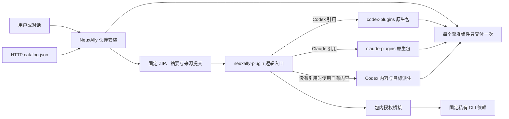
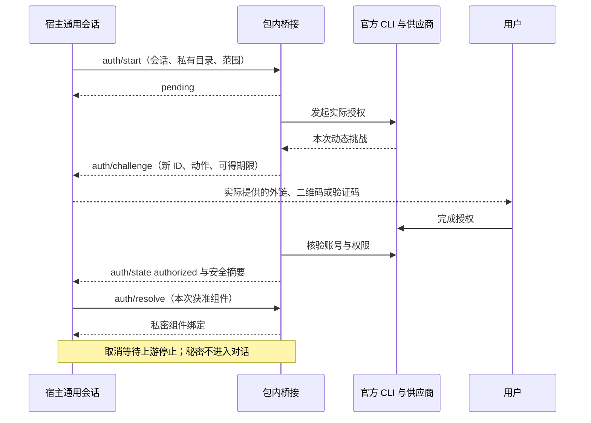

# NeuxAlly 插件

[English](README.md) | [简体中文](README.zh-CN.md)

为 [NeuxAlly](https://github.com/JieWaZi/NeuxAlly) 独立维护的公开插件源码。应用通过 HTTP 查询目录，在用户为伙伴安装插件时下载并核验固定快照。

| 系统插件 | 内容与真实来源 | 目标选择 |
| --- | --- | --- |
| [GitHub](neuxally-plugin/github/README.md) | OpenAI 与 Claude 官方 marketplace 的完整原生包 | Codex → OpenAI GitHub；Claude Code → Claude GitHub |
| [飞书办公](neuxally-plugin/feishu-office/README.md) | 自有 Codex 包，保留完整官方 Lark 技能与包内授权桥接 | 使用自有 Codex 内容；其他目标可派生兼容内容 |

目录存在、归档可下载、CLI 已加载与真实账号验证是不同事实。本仓库测试覆盖打包与授权协议行为，不代表真实账号或全部目标 CLI 兼容性验收。

## 安装与使用

在支持 v2 目录的 NeuxAlly 中打开资源库的插件页面，选择系统插件并安装到伙伴，需要时完成声明的授权。对话安装应通过宿主能力发现取得 `allycli` 插件安装能力，调用同一用例；不能改写用户的 Codex 或 Claude 全局插件注册表。

**系统逻辑插件**是为伙伴安装一次的统一入口。它的版本、共享账号和伙伴关系保持稳定，宿主按当前 CLI 选择实现。`neuxally-plugin/github` 只引用真实原生包，不重新包装上游 MCP 定义。有明确目标原生引用时优先使用；只有没有该目标引用时才可使用已有自有内容。纯引用入口没有目标实现时明确失败。

直接使用原生插件时，[.agents/plugins/marketplace.json](.agents/plugins/marketplace.json) 索引 Codex 内容，[.claude-plugin/marketplace.json](.claude-plugin/marketplace.json) 索引真实 Claude 包。通过 `codex plugin --help` 或 `claude plugin --help` 核对本机版本支持的命令与作用域。原生安装不会自动提供 NeuxAlly 账号、授权界面或私有依赖环境；CLI 无法固定 marketplace 版本时，应使用已审阅的固定提交本地快照。



## 目录职责

- `codex-plugins/`：完整保留上游 Codex 包，包括 apps、MCP 与资产，新增来源记录明确标注。
- `claude-plugins/`：真实上游 Claude 包，保留全部原生组件及可得的许可。
- `neuxally-plugin/`：系统逻辑入口与自有 Codex 标准内容。身份来自 `.codex-plugin/plugin.json`；可选 `.neuxally/integration.json` 只增加原生引用与授权，不建立第二份组件列表。
- `patches/`：可审阅的 CLI 隔离补丁、回归源码和历史第三方声明。
- `scripts/`：可重现的目录、ZIP 和固定依赖构建。生成的 `dist/` 不提交。

两种 GitHub 原生实现的授权模型不同。OpenAI 包保留托管 `.app.json` 和公共 OAuth 客户端声明，不代表当前宿主一定能提供托管连接。Claude 包要求通过受保护配置提供 `GITHUB_PERSONAL_ACCESS_TOKEN`。用户 token 必须保密；公开分发的 OAuth 客户端 secret 不是用户凭据。详见各包原文与 [来源声明](THIRD_PARTY_NOTICES.md)。

## 编写自有 Codex 插件

创建 `neuxally-plugin/<key>/.codex-plugin/plugin.json`，使用标准 `name`、`version`、`description` 和准确的作者/许可字段。遵循官方 [Codex 打包文档](https://developers.openai.com/plugins/build/plugins) 增加完整 `skills/`、`.mcp.json` 与其他原生组件。保留脚本、相对资料、资产和执行位，不另造插件清单；没有 `.neuxally/` 仍是标准包。

搜集上游时核对真实仓库与 marketplace，固定完整提交，复制整个包目录而不改写原生声明；在 `provenance.json` 保存作者、版权、可得的许可、来源路径和逐文件摘要。核对原生依赖及宿主限制。目录名或相似产品名不能证明存在等价实现，不能伪造缺失原生包。清单中的许可字段只能作为其实际声明证据，不补造版权声明。

关联已核验的原生实现时，在包内增加可选扩展：

```json
{
  "nativePlugins": {
    "codex": { "path": "codex-plugins/github" },
    "claude": { "path": "claude-plugins/github" }
  }
}
```

路径相对已核验来源根解析，而不是相对逻辑入口。发布 ZIP 包含入口及它引用的完整原生目录。绝对路径、目录越界、缺失原生清单与符号链接均拒绝；单包导入不能越出自身快照。逻辑版本与原生版本分别追踪；上游未声明版本时不虚构版本。

## HTTP 查询与下载

默认元数据地址：[最新目录](https://github.com/JieWaZi/NeuAally-Plugins/releases/latest/download/catalog.json)。可重现操作使用 [固定 v2.0.0 目录](https://github.com/JieWaZi/NeuAally-Plugins/releases/download/v2.0.0/catalog.json)。维护者发布 Release 后这些地址才可用，源码提交不等于已发布。

```sh
curl --fail --location https://github.com/JieWaZi/NeuAally-Plugins/releases/download/v2.0.0/catalog.json --output catalog.json
curl --fail --location https://github.com/JieWaZi/NeuAally-Plugins/releases/download/v2.0.0/github.zip --output github.zip
shasum -a 256 github.zip
```

构建生成 `{schemaVersion:2,entries:[...]}`，每项含 `key`、完整 `sourceCommit`、不可变 `archiveURL`、`archiveSHA256`、`packagePath`、`name`、逻辑 `version`、`description` 和 `format: codex`。这是目录传输元数据，不是第二份运行插件清单。搜索只读目录；安装选中项才下载 ZIP，先核对 SHA-256 再解包，保留固定来源身份。本地目录和 HTTP 镜像可提供相同契约。已安装内容不随 `latest` 改变；不可原地替换 Release 资产，应发布新版本。

## 声明驱动的授权

标准 MCP 优先采用已支持的认证声明和 discovery。非标准 CLI 在 `.neuxally/integration.json` 声明 `authentication`，选择 `strategy: plugin-command`、`protocol: neuxally-auth/1`、受信程序与包内参数，实现 start/status/cancel/resolve/logout。宿主负责通用会话与动作界面，插件解释供应商协议。精确字段与私密 resolve 示例见 [已实现桥接契约](neuxally-plugin/feishu-office/.neuxally/auth/README.md)。

飞书桥接首次使用把固定摘要的隔离 CLI 下载到私有目录，逐阶段提供真实挑战，通过官方 CLI 核验身份与范围，并清空继承的 CLI 凭据覆盖值。宿主只接收安全账号摘要，将获准组件绑定通过私密执行通道交付。受信宿主也可通过 `NEUXALLY_LARK_CLI` 提供同一固定依赖；新增供应商无需给宿主增加下载代码或专用界面。



## 构建与发布

需要 Node 22+、Git；可选 CLI 依赖构建固定 `go1.25.8`。先构建六个平台的 CLI，审阅并提交生成的资产锁，再从该源码提交构建目录。依赖构建应用公开补丁并运行定向钥匙串回归，通过 `CGO_ENABLED=0` 交叉编译固定程序。

```sh
npm test
node scripts/build-lark-provider.mjs
# 先审阅并提交源码和生成的 assets.lock.json。
node scripts/build-catalog.mjs HEAD v2.0.0
```

目录构建接受完整提交 SHA（或由 Git 解析的 `HEAD`），只读 Git 对象，保留文件内容与执行位。相同提交产生相同 ZIP，不受脏工作区或文件时间影响。构建先核验全部引用并完成所有产物，再替换目录输出。构建 ZIP 时保留依赖的 `dist/providers/` 目录。

评审后，维护者可执行 `gh release create v2.0.0 --repo JieWaZi/NeuAally-Plugins --target <完整源码提交> --title 'Plugins v2.0.0' --notes-file <已审阅发布说明> dist/catalog.json dist/*.zip dist/providers/*` 创建不可变 Release。仅在获准后推送对应提交与标签。构建、许可核对和真实账号/平台验收分别记录。

根目录 [MIT 许可](LICENSE) 适用于 NeuxAlly 自有内容；第三方内容保留原许可，详见 [第三方声明](THIRD_PARTY_NOTICES.md)。
