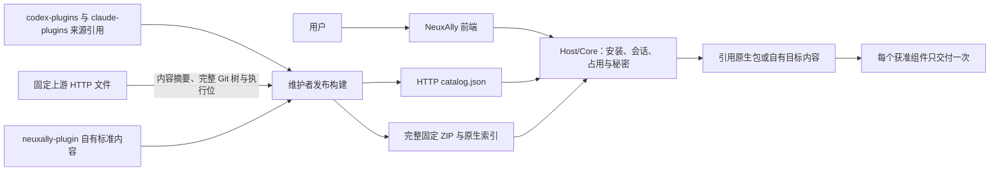
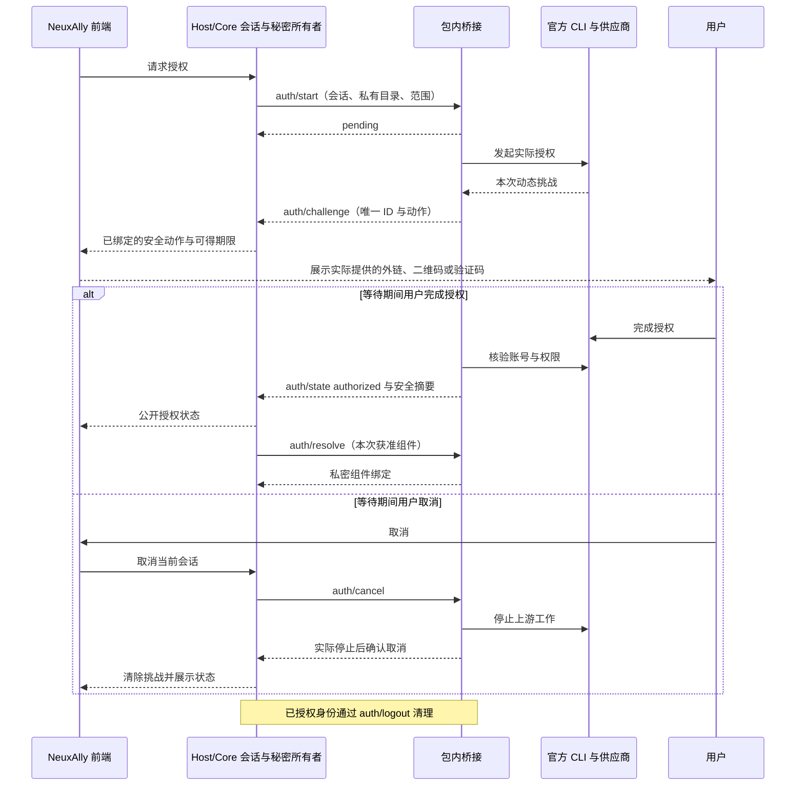

# NeuxAlly 插件

[English](README.md) | [简体中文](README.zh-CN.md)

面向 GitHub 代码审查与协作，以及飞书文档、多维表格、日程和任务的插件库与 marketplace。[NeuxAlly](https://github.com/JieWaZi/NeuxAlly) 通过 HTTP 查询目录，为伙伴安装固定且已核验的内容。

仓库根目录管理多个插件，不是单个插件，因此没有根级单插件 `plugin.json`。标准清单位于每个自有包，或发布构建还原后的完整原生包内。

| 插件 | 业务能力 | 维护内容 |
| --- | --- | --- |
| [GitHub](neuxally-plugin/github/README.md) | 检索仓库代码、跟进议题和拉取请求、审查变更与协作 | 自有逻辑入口，引用固定 OpenAI 与 Claude 原生来源 |
| [飞书办公](neuxally-plugin/feishu-office/README.md) | 编写文档、管理多维表格、安排日程与跟进任务 | 自有 Codex 标准包、完整 Lark 技能和包内授权桥接 |

目录存在、归档可下载、目标 CLI 已加载与真实账号已验证分别记录。发布归档不等于完成账号或平台验收。

## 安装与使用

在支持 v2 目录的 NeuxAlly 中打开资源库，为伙伴安装插件，需要时完成声明的授权。对话安装通过宿主能力发现取得 `allycli` 安装能力，调用相同用例，不改写用户的 Codex 或 Claude 全局注册表。

系统逻辑插件为伙伴安装一次，保留一份关系和逻辑版本，由宿主选择当前 CLI 的固定实现。有明确原生引用时优先使用；只有没有该目标引用时才使用已有自有内容。纯引用入口没有适用实现时明确失败。

直接使用原生插件时：

- 源码 [.agents/plugins/marketplace.json](.agents/plugins/marketplace.json) 只登记当前检出中真实存在的自有飞书包，不指向只有 `source.json` 的 GitHub 目录。
- 源码 [.claude-plugin/marketplace.json](.claude-plugin/marketplace.json) 使用 Claude 官方 [`git-subdir` 来源](https://code.claude.com/docs/en/plugins/marketplace-reference#git-subdir-plugin-source)，固定完整提交和包路径。直接原生安装可使用 Git，NeuxAlly 的 HTTP 安装链路不依赖 Git。
- 每个安装 ZIP 都包含完整实现和根目录下生成的本地原生索引。解开 `github.zip` 可取得完整 Codex/Claude marketplace 快照；`feishu-office.zip` 提供自有 Codex 快照。Codex GitHub 的本地原生索引随完整发布快照提供。

通过本机 CLI 帮助核对支持的命令和作用域。原生加载本身不会提供 NeuxAlly 账号、私有执行环境或授权界面。只有来源描述的原生目录不能直接作为插件加载。



## 目录职责与原生来源登记

- `codex-plugins/`：原生上游地址、完整提交、包路径、完整树与逐文件完整性锁，以及必要许可证据；上游源码和资产在构建时下载。
- `claude-plugins/`：同样维护真实 Claude 原生来源；来源描述本身不是可加载的原生包。
- `neuxally-plugin/`：自有逻辑入口与自有 Codex 标准内容。`.codex-plugin/plugin.json` 定义身份和标准组件；可选 `.neuxally/integration.json` 只补充原生引用与授权。
- `patches/`：公开 CLI 隔离补丁、回归源码与准确的历史来源声明。
- `scripts/`：来源登记、HTTP 还原、可重现 ZIP/目录和可选依赖构建。`.cache/` 与 `dist/` 均忽略。

收录上游时核对真实官方仓库、marketplace、作者与许可，选择完整提交和真实包子目录，登记来源和完整性锁，不长期维护一份复制的上游源码：

```sh
node scripts/lock-native-source.mjs codex-plugins/example https://github.com/example/plugins <完整40位提交> plugins/example
```

登记命令通过 HTTP 读取完整上游树元数据和文件，生成 `source.json` 的 `repository`、`commit`、`path`、`treeSHA`、逐文件 SHA-256 与 Unix 模式，核验完整 Git 树，并保留已审阅的作者/许可元数据。提交前须审查这些信息并保留必要许可证据。符号链接、子模块、越界路径、重复文件、错误执行位和不完整树均拒绝。当前来源传输支持 GitHub HTTPS 仓库。

发布构建只通过 HTTP 下载这些固定文件，内容校验后才进入缓存，完整包树核验后才进入 ZIP。损坏缓存重新获取，已核验缓存支持离线重建；HTTP 失败不会替换既有发布产物。这样能保留明确的上游来源，避免持续提交上游源码副本。

## 自有标准包与原生引用

在 `neuxally-plugin/<key>/.codex-plugin/plugin.json` 编写标准身份、版本、描述及准确作者/许可。按官方 [Codex 打包文档](https://developers.openai.com/plugins/build/plugins) 添加完整 skills、MCP 与其他原生组件，保留脚本、相对引用、资产和执行位；没有 `.neuxally/` 仍是标准包。

逻辑入口可以关联已审阅的原生来源，不重复其组件定义：

```json
{
  "nativePlugins": {
    "codex": { "path": "codex-plugins/github" },
    "claude": { "path": "claude-plugins/github" }
  }
}
```

路径相对已核验发布来源根解析。源码检出在这些路径保存引用；安装 ZIP 在相同路径还原完整原生实现。应用继续消费原有 v2 归档契约，不需要 Git 程序。逻辑版本和原生版本分别追踪，上游没有版本时不虚构。

OpenAI GitHub 保留托管 app 声明和公共 OAuth 客户端配置；Claude GitHub 要求通过受保护配置提供 `GITHUB_PERSONAL_ACCESS_TOKEN`。二者不能证明另一个账号模型在当前宿主可用，用户 token 必须保密。详见 [来源与许可证据](THIRD_PARTY_NOTICES.md)。

## HTTP 查询、版本固定与离线快照

使用 [最新目录](https://github.com/JieWaZi/NeuAally-Plugins/releases/latest/download/catalog.json) 查询，或用 [固定 v2.0.1 目录](https://github.com/JieWaZi/NeuAally-Plugins/releases/download/v2.0.1/catalog.json) 保持可重现；新版本只有维护者发布后才可下载。

```sh
curl --fail --location https://github.com/JieWaZi/NeuAally-Plugins/releases/download/v2.0.1/catalog.json --output catalog.json
curl --fail --location https://github.com/JieWaZi/NeuAally-Plugins/releases/download/v2.0.1/github.zip --output github.zip
shasum -a 256 github.zip
```

解包前把下载摘要与所选目录项比较。传输清单仍为 `{schemaVersion:2,entries:[...]}`，每项包含 `key`、完整 `sourceCommit`、不可变 `archiveURL`、`archiveSHA256`、`packagePath`、`name`、逻辑 `version`、`description` 与 `format: codex`。它是目录元数据，不是第二份插件清单。

搜索只读取目录；安装时下载所选完整 ZIP。离线安装快照保留逻辑入口、所有引用的原生文件、完整性/许可证据和适用的本地原生索引，便于镜像，也不要求客户端解析上游 Git ref。独立服务及首次 CLI 依赖仍可能需要联网和授权。已安装内容不随 `latest` 改变；更新发布新版本，不覆盖旧资产。

## 声明驱动的授权

标准 MCP 优先采用已支持的认证声明和 discovery。非标准 CLI 在 `.neuxally/integration.json` 声明 `authentication`，选择 `strategy: plugin-command`、`protocol: neuxally-auth/1`、受信程序与包内参数，实现 start/status/cancel/resolve/logout。NeuxAlly 前端只展示 Core 绑定的动态动作并发送取消请求；Host/Core 管理会话、占用与私密执行绑定，包内桥接解释供应商协议。供应商凭据和原始协议帧不进入前端。精确字段与私密 resolve 示例见 [已实现桥接契约](neuxally-plugin/feishu-office/.neuxally/auth/README.md)。

飞书桥接首次使用把固定摘要的隔离 CLI 下载到私有目录，逐阶段提供真实挑战，通过官方 CLI 核验身份与范围，并清空继承的 CLI 凭据覆盖值。宿主只接收安全账号摘要，将获准组件绑定通过私密执行通道交付。受信宿主也可通过 `NEUXALLY_LARK_CLI` 提供同一固定依赖；新增供应商无需给宿主增加下载代码或专用界面。



## 构建与发布

使用 Node 22+ 与 Git 构建已提交的来源快照。Git 只读取本仓库，上游原生内容由 HTTP 获取。先审阅并提交来源锁和自有清单：

```sh
npm test
node scripts/build-catalog.mjs HEAD v2.0.1
```

构建器还原固定上游树、校验原生清单，在忽略的 `dist/` 生成可重现 ZIP 和目录，保留文件原文与执行位。相同输入和已核验缓存产生相同 ZIP；脏工作区内容不会进入固定提交。

v2.0.1 的两个逻辑入口均为 `2.0.1`。飞书依赖锁继续引用既有 v2.0.0 不可变 CLI 资产，不必重建或重新上传二进制。`scripts/build-lark-provider.mjs` 保留给以后明确的依赖更新，继续固定工具链、公开补丁和完整许可收集。

评审并获准后，只把 `dist/catalog.json`、`dist/github.zip`、`dist/feishu-office.zip` 发布到指向精确来源提交的新 v2.0.1 Release，保持历史资产不变。构建检查不能替代真实 CLI、账号、平台或视觉验收。

根目录 [MIT 许可](LICENSE) 适用于 NeuxAlly 自有内容；第三方内容与发布快照保留其实际条款，详见 [第三方声明](THIRD_PARTY_NOTICES.md)。
