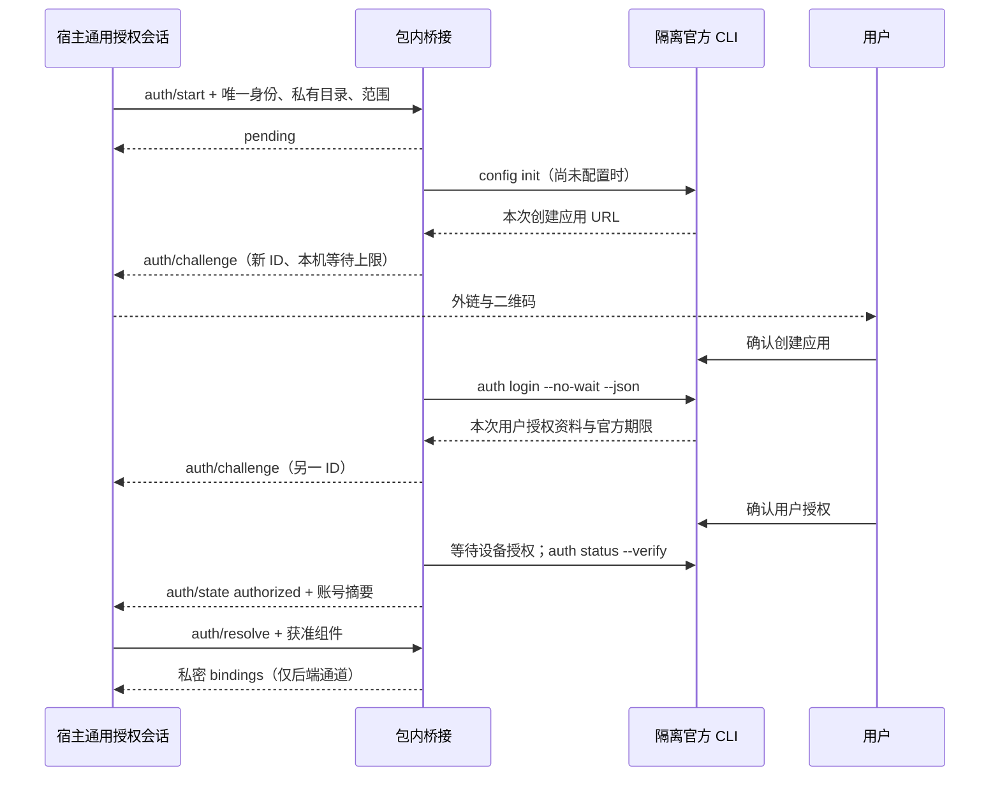

# 插件授权桥接

本目录实现可选扩展 `neuxally-auth/1`，不属于 Codex、Claude 或 MCP 标准。Node 22 以上通过包内 `authorize.mjs` 启动，stdin/stdout 为逐行 JSON-RPC 2.0；stdout 只包含协议，原始供应商输出不向宿主传播。

## 接入与身份

在包的 `.neuxally/integration.json` 声明 `authentication.strategy: plugin-command`、`protocol: neuxally-auth/1`、`command: node` 与包内 `args`。标准身份、Skills 和 MCP 继续由原生清单定义。宿主提供受信 Node、插件私有 `dataDirectory`、`pluginId`、唯一 `sessionId`、获准 `scopes`，并把入口参数按包路径解析；不拼接 shell。

同一桥接进程绑定首次请求的完整身份和权限集；后续请求改变这些字段会被拒绝。宿主负责唯一插件会话、伙伴共享引用、活跃执行占用及退出时取消。插件负责解释自身供应商、动态挑战、实际状态与私密 resolve，不需要宿主为新供应商增加分支。

## 消息

每个请求都带 `params: {sessionId,pluginId,dataDirectory,scopes}`。响应 `id` 与请求一致；`auth/resolve` 还带 `components: [{componentId,key,target,url?}]`，其中本插件只接受实际存在的 `skills/<name>/SKILL.md`、`target: skill` 且没有 URL 的组件。

| 方法 | 结果与职责 |
| --- | --- |
| `auth/start` | 立即 `{state: "pending"}`，异步开始或复用当前等待 |
| `auth/status` | `{state,account}`，使用 `auth status --json --verify` 核验身份与所需范围 |
| `auth/cancel` | 真正结束当前 CLI 工作后返回 `{state: "cancelled"}` |
| `auth/resolve` | `{bindings:[{componentId,environment,headers?}]}`，只给本次明确获准组件的后端执行环境 |
| `auth/logout` | 停止授权后通过官方 CLI 退出，返回 `{state: "unauthorized"}`；仅宿主确认无共享引用/占用时调用 |

`account` 只含 `configured`、`available`、`id`、`name`、`appId` 与 `scopes`，不含凭据。运行态采用 `pending`、`authorized`、`expired`、`cancelled`、`failed`；未授权查询采用 `unauthorized`。CLI 退出成功不代表已授权，必须通过完成事件、服务端验证和范围检查。

`auth/challenge` 通知含 `{sessionId,challengeId,actions,expiresAt?,deadlineAt?}`。每阶段生成新挑战 ID；`open-url` 用 `url`，`show-qr` 与 `copy-code` 用 `value`。只有供应商实际支持跨设备的流程才能展示二维码。官方到期为 Unix 毫秒 `expiresAt`；创建应用没有官方期限时只声明本机十分钟 `deadlineAt`，不冒充官方有效期。当前飞书流程没有公开单独验证码，不生成静态或虚构验证码。

`auth/state` 通知含 `{sessionId,state,account?,errorCode?}`。上游原始帧、token、设备秘密和错误原文不进入 UI、聊天、索引或日志。取消、到期和阶段更新必须使旧挑战失效；宿主只接受当前会话。



私密 resolve 示意，路径为虚构例子，不能作为公开回执：

```json
{"jsonrpc":"2.0","id":5,"result":{"bindings":[{"componentId":"approved-component","environment":{"LARKSUITE_CLI_CONFIG_DIR":"/managed/example/profile","LARKSUITE_CLI_DATA_DIR":"/managed/example/credentials","LARKSUITE_CLI_ACCESS_TOKEN":"","LARKSUITE_CLI_NO_UPDATE_NOTIFIER":"1","LARKSUITE_CLI_NO_SKILLS_NOTIFIER":"1","PATH":"/managed/example/cache:/trusted/runtime/bin"}}]}}
```

宿主必须验证 `componentId` 属于本次获准内容且不可更换已准许端点或身份，然后沿受保护执行配置交付。上例以空值清空继承的外部 token；实际清空所有已继承的 `LARKSUITE_CLI_*` 覆盖值。不要把 `environment` 或 `headers` 复制进公共回执。

## CLI 依赖与凭据隔离

`assets.lock.json` 固定本插件六个平台的原始可执行文件、下载 URL、SHA-256、大小、上游提交、工具链和隔离补丁摘要。`assets.mjs` 首次从 HTTPS 下载，校验后原子写入私有 `cache/`；缓存每次核对摘要，错误、超长或中断下载不能成为可执行产物。宿主可通过受信 `NEUXALLY_LARK_CLI` 提供相同固定隔离构建；不通过 PATH 查找未知 lark-cli。

`LARKSUITE_CLI_CONFIG_DIR` 本身不隔离上游 Windows 注册表和 macOS 钥匙串。仓库 [隔离补丁](../../../../patches/lark-keychain-isolation.patch) 在 Get/Set/Remove 共用存储边界把服务名绑定私有 profile 摘要，覆盖 App Secret、用户 token 与 DPoP 等经该接口保存的凭据；无受管 profile 时保持上游行为。macOS 的凭据与 DPoP 文件同时遵守私有数据目录；配置、凭据目录为 `0700`，不同插件不能通过相同账号名共享身份。

本目录测试不证明真实平台钥匙串、网络供应商、用户扫码或所有目标 CLI 的运行验收。发布前须由维护者确认真实账号和目标平台边界。

CLI 的传递依赖与 Go runtime 许可原文随 [THIRD_PARTY_NOTICES.cli.txt](THIRD_PARTY_NOTICES.cli.txt) 交付，构建时从真实跨平台依赖图收集，不把根 MIT 许可覆盖到依赖。
